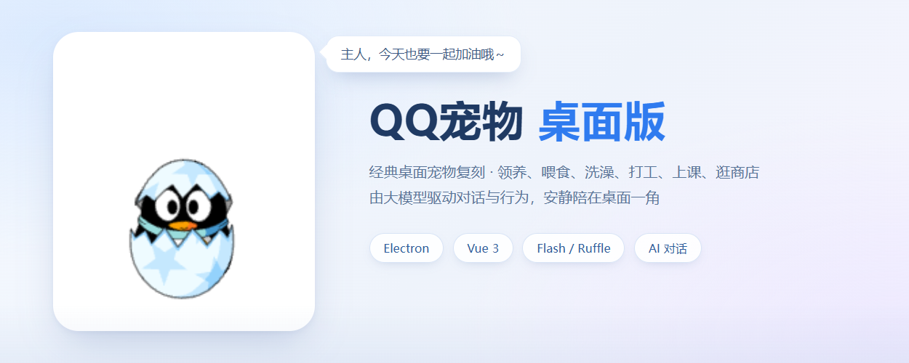
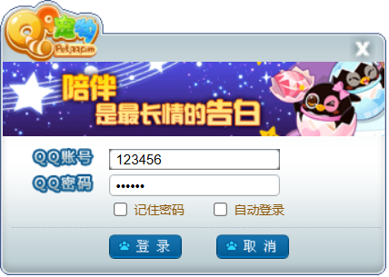
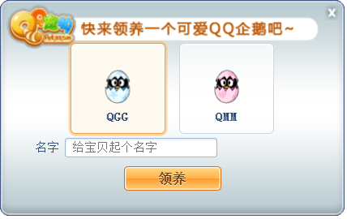
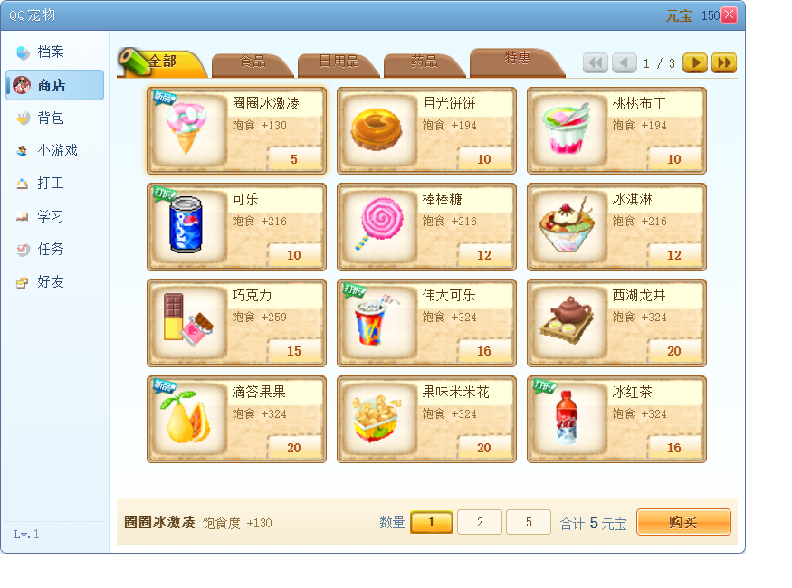
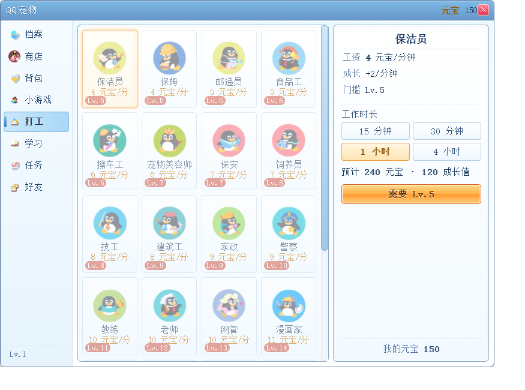
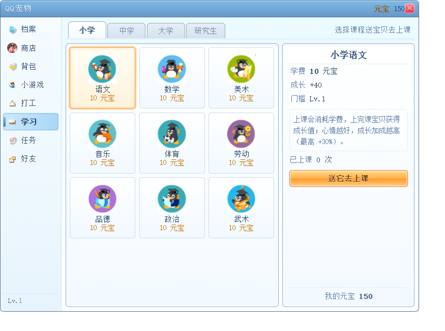
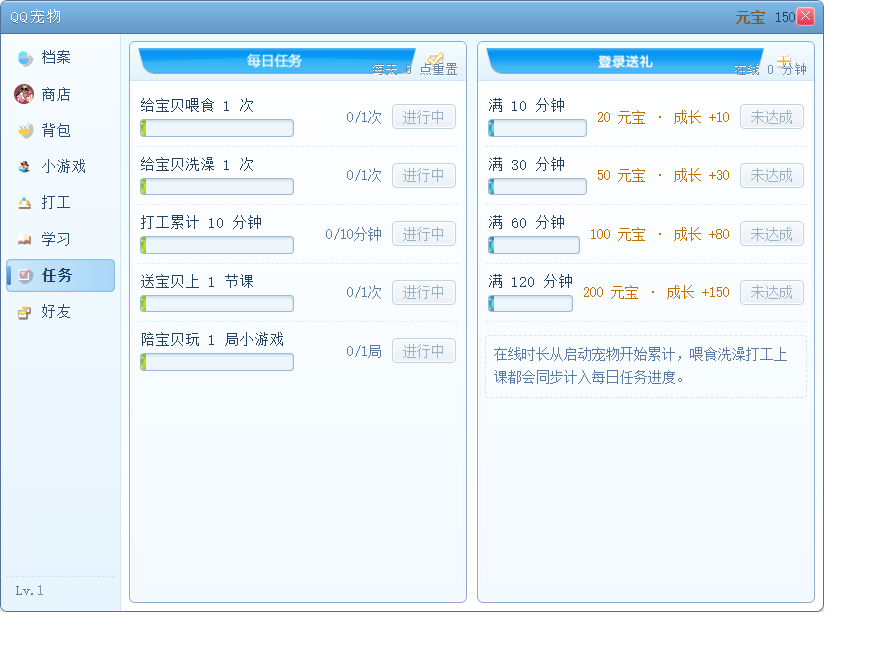
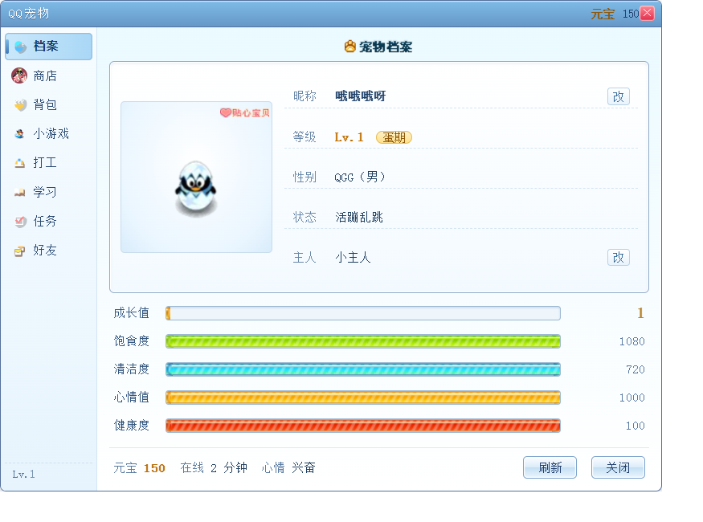
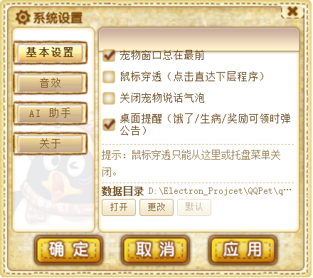

# QQ宠物 (QQPet)

<p align="center">
  
</p>

一个复刻经典「QQ宠物」桌面宠物的跨平台桌面应用，基于 **Electron + Vue 3** 构建。宠物以 **Flash（Ruffle）动画** 呈现，支持领养、喂食、清洁、养宠升级、商店购物、打工、上课、每日任务、迷你小游戏与宠物档案等养成玩法；接入大模型后，宠物还能自己说话、并根据聊天内容主动做动作。

## 界面预览

<table>
  <tr>
    <td width="50%" align="center"></td>
    <td width="50%" align="center"></td>
  </tr>
  <tr>
    <td align="center"><sub><b>登录</b> · 复刻经典 QQ 登录窗，支持记住密码与自动登录</sub></td>
    <td align="center"><sub><b>领养</b> · 选择 QGG / QMM，给宠物起名字</sub></td>
  </tr>
  <tr>
    <td width="50%" align="center"></td>
    <td width="50%" align="center"></td>
  </tr>
  <tr>
    <td align="center"><sub><b>商店</b> · 食物、日用品、药品分类选购，元宝结算</sub></td>
    <td align="center"><sub><b>打工</b> · 按等级解锁岗位，按时长结算元宝与成长值</sub></td>
  </tr>
  <tr>
    <td width="50%" align="center"></td>
    <td width="50%" align="center"></td>
  </tr>
  <tr>
    <td align="center"><sub><b>学习</b> · 小学到研究生课程，心情越好加成越高</sub></td>
    <td align="center"><sub><b>任务</b> · 每日任务与在线时长奖励</sub></td>
  </tr>
  <tr>
    <td width="50%" align="center"></td>
    <td width="50%" align="center"></td>
  </tr>
  <tr>
    <td align="center"><sub><b>宠物档案</b> · 等级、成长值、饱食度、清洁度、心情与健康</sub></td>
    <td align="center"><sub><b>系统设置</b> · 窗口置顶、鼠标穿透、音效、AI 助手与数据目录</sub></td>
  </tr>
</table>

## 功能特性

- **桌面宠物**：无边框透明窗口，Flash（Ruffle）动画驱动，支持拖拽、贴边隐藏、鼠标穿透与托盘常驻。
- **养成系统**：喂食、洗澡、玩耍、生病治疗，等级与成长值、属性随时间的自然衰减。
- **打工与学习**：按等级解锁岗位与课程，按时长/次数产出元宝、成长值，心情影响收益加成。
- **商店与背包**：食物、日用品、药品三类商品，购买后进入背包，双击即可使用。
- **每日任务与在线奖励**：喂食、洗澡、打工、上课、游戏等行为计入任务进度。
- **AI 助手**：兼容任意 OpenAI 格式接口，宠物可自主对话，并据聊天内容触发吃东西、洗澡、打工等动作；支持本地记忆（事实沉淀、历史检索、导出）。
- **多窗口架构**：宠物窗口、宠物中心（商店/背包/游戏/打工/学习/任务/好友）、设置、帮助等独立窗口，统一皮肤化 UI。

## 项目设置

### 安装依赖

```bash
npm install
```

### 启动开发

```bash
npm run dev
```

### 生产构建 / 打包

```bash
# 仅构建（out/ 目录，不打包安装包）
npm run build

# 打包安装包
npm run build:win    # Windows（NSIS 安装器）
npm run build:mac    # macOS（dmg）
npm run build:linux  # Linux（AppImage / snap / deb）
```

> Windows 安装包产物位于 `dist/`，如 `qqpet-<版本>-setup.exe`（向导式安装，可选择安装目录并创建桌面快捷方式）。

## 技术栈

| 层次 | 选型 |
| --- | --- |
| 桌面容器 | Electron 39 |
| 界面 | Vue 3 + 原生多页 HTML 入口（electron-vite 构建） |
| 动画 | Ruffle（Flash 运行时，加载原始 SWF 资源） |
| 数据 | 本地 JSON / JSONL 存储，数据目录可自定义 |

## 截图生成

`docs/screenshots/` 下的界面图由脚本采集，便于版本更新后同步刷新：

```bash
# 1) 带调试端口启动应用
npx electron . --remote-debugging-port=9222

# 2) 采集各功能窗口截图
node scripts/shots.mjs

# 3) 重新生成顶部横幅（可选）
npx electron scripts/hero-shot.cjs
```
